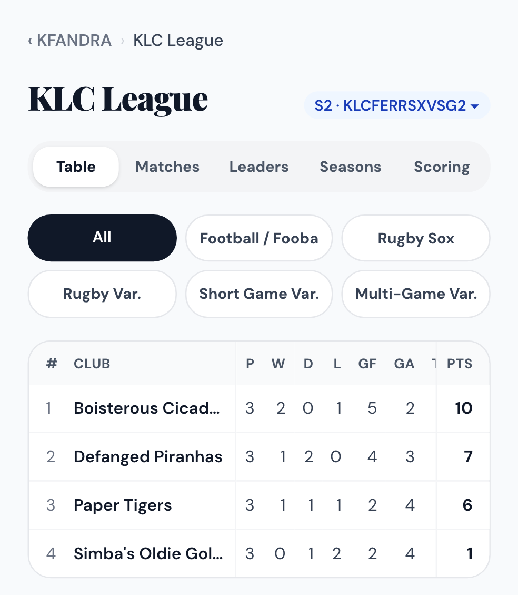
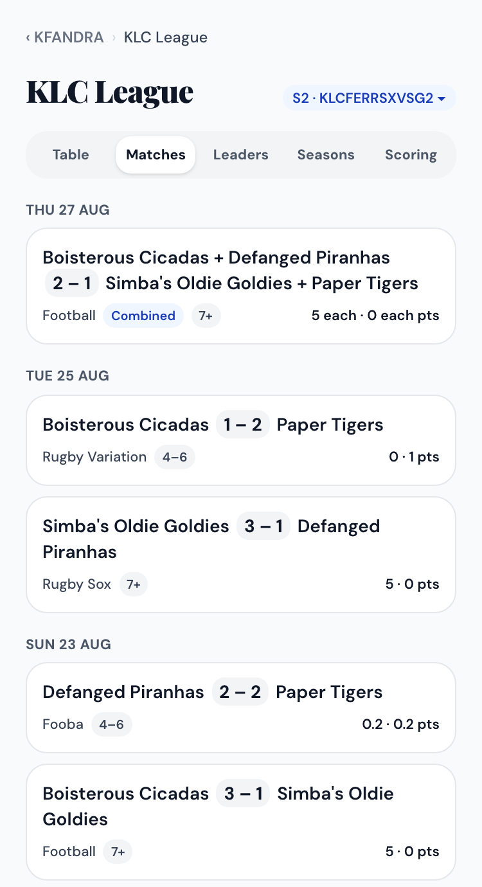
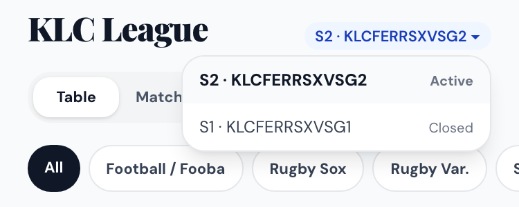

# KLC League Guide

How to use the **KLC League** section of the app: tables, results, leaders, and
recording matches. No technical knowledge needed.

> **In one line:** club managers record and submit their own club's matches, the
> app works out the league points automatically, and every player can see the
> tables, results and leaderboards.

<!-- Source of docs/klc-league-guide.pdf. Rebuild with `npm run docs:pdf:league`. -->

---

## 1. Finding it — everyone

- On the home screen, tap **KLC League** (under Club Balance Sheet).
- Club managers and KFANDRA also see a **Record a match** link just below it.

At the top of the KLC League page:

- **The season pill** (e.g. `S2 · KLCFERRSXVSG2 ▾`). Tap it to switch season. It opens on the season that's running.
- **Five tabs:** Table · Matches · Leaders · Seasons · Scoring.

## 2. Table — everyone

Pick a table with the buttons under the tabs (all six are always visible):

- **All**: every official match, combined
- **Football / Fooba**
- **Rugby Sox**
- **Rugby Var.** (Rugby Variations)
- **Short Game Var.** (Football Short Game Variations)
- **Multi-Game Var.** (KLC's Multi-Game Variations)

On a phone, **swipe the middle columns** sideways. The club name and points stay put.

| Column | Meaning |
|---|---|
| P · W · D · L | Played, won, drawn, lost |
| GF · GA | Goals for and against (Football, Fooba, Short Game) |
| TF · TA | Tries for and against (Rugby Sox, Rugby Variations) |
| Diff | (goals + tries for) minus (goals + tries against) |
| Pts | League points |

**Order:** most points first. Ties are broken by Diff, then by goals + tries
scored, then by club name.

## 3. Matches — everyone

The Matches tab lists every **submitted** league match in the season, newest
first, grouped by date. Each card shows:

- the clubs and the score
- the match type
- the player-count tier: **7+**, **4–6** or **2–3**
- the points each side earned

A **Combined** (joint-manager) match lists both clubs on each side and shows
"each": every club on the winning side gets the full points.

Tap a match to see its full record (squads and stats), read-only.

> Friendlies don't appear here and earn no league points.

## 4. Leaders — everyone

The top 10 for the season on each board:

- **Goals** (includes Fooba main and rebound goals)
- **Tries**
- **Assists** and **Pre-assists**
- **Saves**
- **Tackles**
- **Discipline** (yellow, red and blue cards, plus late challenges)
- **Kroopies**
- **MMG**

The same chips as the Table tab filter by match type. Each player shows the
club they played for most recently. Only **MMG** also counts friendlies.
Players with tied totals share a rank.

## 5. Seasons and Scoring — everyone

- **Seasons** lists every season with its status (Active, Upcoming, Closed) and
  dates. Tap one to see its tables.
- **Scoring** shows the points scale the app is using right now (below).

## 6. How points are worked out

Points depend on the match type and the number of players, **counting both
teams together**.

| Win | 7+ players | 4–6 players | 2–3 players |
|---|---|---|---|
| Football / Fooba | 5 | 1 | 0.5 |
| Rugby Sox | 5 | 1 | 0.5 |
| Rugby Variation | 3 | 1 | 0.5 |
| Short Game Variation | 3 | 1 | 0.5 |
| Multi-Game Variation | 3 | 1 | 0.5 |
| **Draw (all types)** | 1 | 0.2 | 0.1 |
| **Loss** | 0 | 0 | 0 |

- **Combined (joint-manager) match:** one result on the total score across both
  halves. Every club on the winning side gets the full win points. On a draw,
  each club gets the draw points.
- **Session limits** (at most 3 matches at 4–6 players, at most 2 at 2–3 players)
  are a ground rule. The app doesn't enforce them.
- Points are always worked out again from the recorded score, so **correcting a
  match updates every table automatically**.

## 7. Recording a match — club managers and KFANDRA

1. On the home screen, tap **Record a match**. You'll see your club's drafts and
   all submitted matches.
2. Under **New match**:
   - Set the date and the match type.
   - Tick **Combined** for a joint-manager match (two halves), and/or
     **Friendly**.
   - Managers also choose **Your club**, which becomes the home side.
   - Tap **+ New match**.
3. In the recorder:
   - Pick the other club.
   - Enter the score.
   - Add each team's players.
   - Tap a player to record their stats.

   Everything saves as you go. There's no Save button.
4. For a combined match, switch to **half 2** and fill it in the same way.
5. Check the **Before submitting** list and the **League points** preview, e.g.
   "Tier 7+ · 3 – 1 · Kraken Leviathans 5 · Paper Tigers 0".
6. Tap **Submit**. The match locks and appears in the tables straight away.

### Rules the recorder checks for you

- **Who can edit:** managers can record and edit matches their club plays in,
  and so can the other club's manager.
- **Keep your own club on the match:** a manager can't remove their last club
  from it.
- **Clubs stay with their pair:** in a combined match, a club can't be on both
  sides (e.g. home in half 1 and away in half 2).
  - Clubs that aren't allowed are greyed out.
  - To swap sides, ask KFANDRA or an admin.
- **League / Friendly** can be switched while the match is a draft. A friendly
  earns no league points and no Kroopies, but still counts towards MMG.
- **Submitting needs an active season:** a league match can only be submitted
  while a season is active. Until KFANDRA starts the season, record friendlies,
  or keep league matches as drafts.

> **Made a mistake after submitting?** A submitted match is locked. Ask
> **KFANDRA** to reopen it, then correct it and submit again. The tables update
> by themselves.

## 8. Running the season — KFANDRA

- **Start a season:** go to Admin → KLC → Seasons and tap **Start**.
  - Only one season runs at a time.
  - Starting a new season closes the old one.
- **Close a season:** tap **Close** when it ends.
  - It's refused while draft matches dated in that season are still open.
  - Submit or delete them first.
- **Which season a match counts for:** the season that's **active when it's
  submitted**.
- **Reopen:** only KFANDRA can reopen a submitted match.
- **Staff** (KFANDRA and admins) can record and edit any club's match.

> If an old match is reopened after the next season has started, resubmitting
> moves it into the new season. Where possible, fix old matches before starting
> the next season.

## 9. Quick answers

| Question | Answer |
|---|---|
| My match isn't in the table. | It's either still a **draft** (not submitted), marked **Friendly**, or a different match type from the chip you picked. Try **All**. |
| Can players see drafts? | No. Only submitted matches appear for everyone. A draft is visible only to the people who can edit it. |
| Why did a 6 v 6 game count as 7+? | Players are counted across both teams: 6 + 6 = 12. |
| Where is Season 1? | Season 1 stays on Coach's sheet. It used older scoring rules, so it isn't re-scored in the app. |
| Who decides the points scale? | KFANDRA. The Scoring tab always shows the scale the app is using. |

*Screenshots use sample data.*
